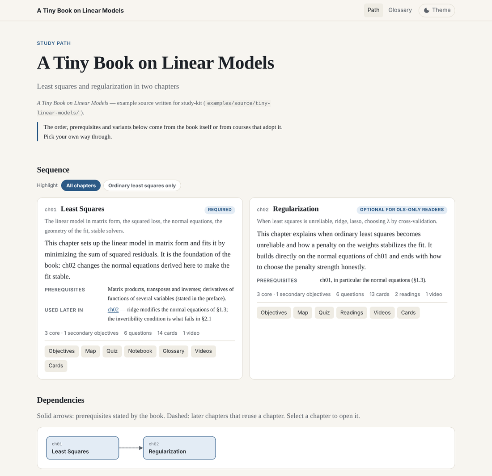
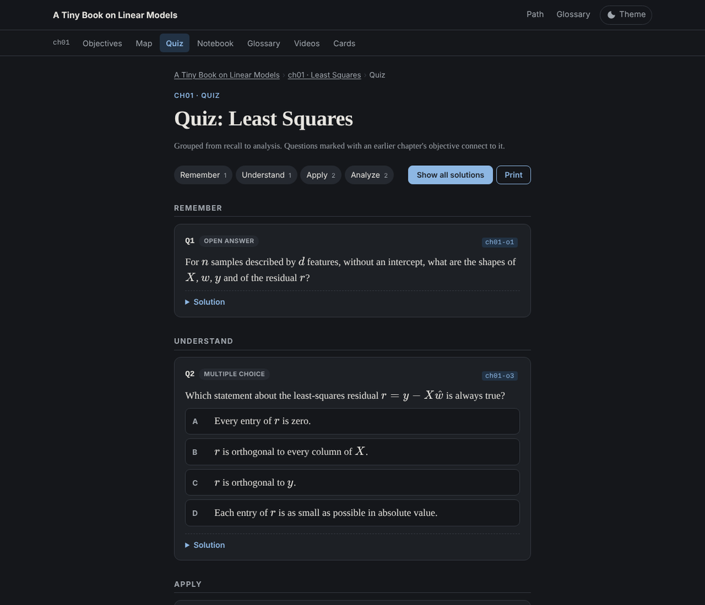
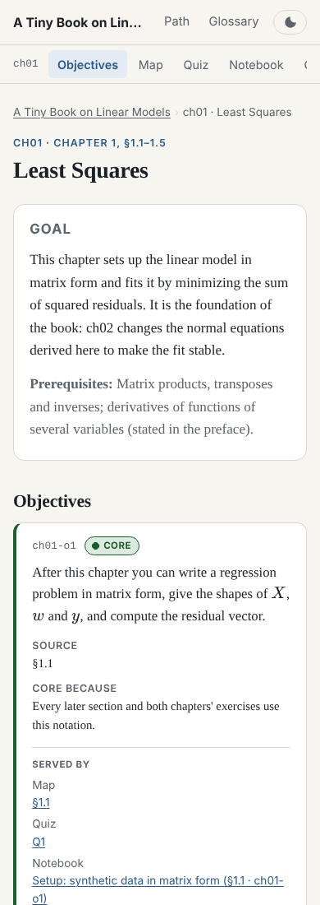
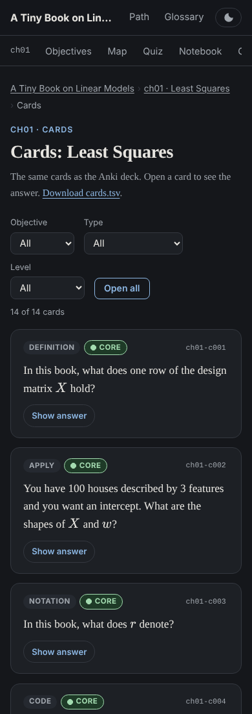

# study-kit

[](https://github.com/gspinaci/study-kit/actions/workflows/ci.yml)
[](https://github.com/gspinaci/study-kit/releases)
[](LICENSE)
[](https://github.com/anthropics/skills)
[](https://gspinaci.github.io/study-kit/)
<!-- After the first Zenodo release, add: [](https://doi.org/10.5281/zenodo.XXXXXXX) -->

**Turn a book into a study website and an Anki deck that stay grounded in the book — and are checked, not just generated.**

study-kit is an [agent skill](https://github.com/anthropics/skills) for Claude (Claude Code, claude.ai) and any agent that reads `SKILL.md`. Give it a book, a chapter, a paper or a syllabus. The agent writes structured **data**; the skill's scripts validate it and render a static, offline-capable **website** plus a styled **Anki deck**.

<p align="center">
  
</p>

<p align="center">
  
  
  
</p>

**[See the example site →](https://gspinaci.github.io/study-kit/)** (built by CI from [`examples/`](examples/))

## What you get

- **The book as a path** (home page): chapters in order with prerequisites and forward links, a dependency graph, and variants *only* when the book or a verified syllabus states them.
- **Per chapter, every page optional**: objectives · map · quiz · notebook · glossary · readings · videos · cards.
- **Everything hooks onto objectives.** Each objective page lists what serves it (map sections, questions, notebook sections, terms, readings, videos, cards), computed by the build — nothing floats outside the path.
- **A deck that matches the site**: one Anki deck, one subdeck per chapter, same palette and badges, light and dark, stable ids so re-imports update cards.

## Why another generator?

Most tools produce shallow definition cards and invented curricula. study-kit is built around hard rules, and most of them are enforced by code rather than by asking nicely:

| Rule | Enforced by |
|---|---|
| Never invent a curriculum: order, prerequisites and variants come from the source or a verified syllabus | `validate.py` (variants need a `source`; `variants: []` renders "none stated") |
| Objectives first: verifiable, *core* or *secondary*, with the reason a core one is core | `validate.py` |
| Every objective is served by something; every item serves an objective | `validate.py` + back-links built by `build_site.py` |
| Depth: ≥3 cards per core objective, one *why* or *apply*; definitions + clozes ≤ 25%; 14 card types | `validate.py`, [`card-types.md`](plugins/study-kit/skills/study-kit/references/card-types.md) |
| Quizzes graded remember → analyze, every distractor explained, cumulative questions | `validate.py` |
| Readings only with what they add beyond the book; DOI or official link | `validate.py` |
| No schedules, durations or coaching — you choose your path | `validate.py` (lint) |
| Paraphrase, don't copy | `validate.py --source` (n-gram overlap) |
| No raw HTML from the model; links, anchors and markup valid; no overflow at 390 px; no console errors | `build_site.py` (escapes), `check_site.py` (crawl + Playwright) |
| Works offline from `file://`, keyboard-operable, WCAG AA in both themes, readable with JS off | templates + `check_site.py` |

## Install

**Claude Code** (plugin marketplace):

```
/plugin marketplace add gspinaci/study-kit
/plugin install study-kit@gspinaci-skills
```

**Any agent supporting Agent Skills** ([skills CLI](https://skills.sh)):

```
npx skills add gspinaci/study-kit
```

**claude.ai**: download `study-kit-skill.zip` from the [latest release](https://github.com/gspinaci/study-kit/releases) and upload it as a custom skill (or zip `plugins/study-kit/skills/study-kit/` yourself).

Python dependencies for the scripts:

```bash
pip install -r plugins/study-kit/skills/study-kit/requirements.txt
python -m playwright install chromium      # optional: visual checks
```

## Use

> Use study-kit on *Mathematics for Machine Learning*, all chapters.
>
> Use study-kit on chapter 4 of the attached PDF — cards and quiz only.

The agent works chapter by chapter, and for each one writes data, validates it, builds the site and looks at screenshots before moving on. You get:

```
study-kit/<book-slug>/
├── data/              book.json, chNN.json, chNN.cards.tsv, chNN.ipynb, chNN.bib, media/   ← source of truth
├── site/              index.html, glossary.html, chNN-<slug>/*.html                         ← open index.html
├── deck.apkg          import into Anki
├── build_site.py      rebuild everything:  python build_site.py --deck
└── _tools/            vendored scripts, so the kit rebuilds without the skill
```

Edit anything in `data/` and run `python build_site.py --deck`: the site and the deck follow.

## The scripts

They live next to the skill and do everything that should not depend on a model's mood.

| Script | Does |
|---|---|
| [`validate.py`](plugins/study-kit/skills/study-kit/scripts/validate.py) `BOOK [--chapter chNN] [--source src.txt] [--strict]` | schema and every mechanical rule above |
| [`build_site.py`](plugins/study-kit/skills/study-kit/scripts/build_site.py) `BOOK [--no-execute]` | `data/` → `site/`; executes notebooks; vendors itself into the kit |
| [`check_site.py`](plugins/study-kit/skills/study-kit/scripts/check_site.py) `BOOK/site [--screenshots DIR]` | link/anchor crawl, markup, leaked syntax; screenshots at 1280/390 px, light/dark |
| [`build_deck.py`](plugins/study-kit/skills/study-kit/scripts/build_deck.py) `BOOK` | styled `deck.apkg` from all `cards.tsv` |
| [`preview_cards.py`](plugins/study-kit/skills/study-kit/scripts/preview_cards.py) `BOOK --theme dark` | the Anki note design in a browser |

The data format is documented in [`references/data-format.md`](plugins/study-kit/skills/study-kit/references/data-format.md). The look is set by design tokens ([`sk_common.py`](plugins/study-kit/skills/study-kit/scripts/sk_common.py)); give a book its own visual direction with a `theme` block in `book.json`.

## Example

[`examples/source/tiny-linear-models/`](examples/source/tiny-linear-models/) is a tiny open book written for this repo (CC BY 4.0); [`examples/study-kit/tiny-linear-models/data/`](examples/study-kit/tiny-linear-models/data/) is the kit's data. It is deliberately partial (chapter 2 has no notebook or glossary) to show that every output is optional. CI validates it, builds and checks the site, publishes it to GitHub Pages, and attaches the deck and screenshots to each run.

Build it locally:

```bash
S=plugins/study-kit/skills/study-kit/scripts
python3 $S/validate.py   examples/study-kit/tiny-linear-models
python3 $S/build_site.py examples/study-kit/tiny-linear-models
open examples/study-kit/tiny-linear-models/site/index.html        # xdg-open on Linux
```

## Evaluating changes to the skill

[`evals/`](evals/) is a small harness for changing `SKILL.md` without guessing:

1. Run each prompt in [`evals/cases.json`](evals/cases.json) in a fresh session (two of them are traps: a request for a 4-week schedule and for an invented variant).
2. `python3 evals/score.py <case> study-kit/<book>` — mechanical checks.
3. Score [`evals/rubric.md`](evals/rubric.md) on a sample, ideally with a reviewer that did not produce the output.

Compare before and after each change.

## Contributing

Issues and PRs welcome — especially eval cases from real books, card types that test something the current 14 miss, and validator rules for mistakes you have seen. See [`CONTRIBUTING.md`](CONTRIBUTING.md).

## Cite

See [`CITATION.cff`](CITATION.cff) (GitHub shows a "Cite this repository" button).

## License

- Code, templates and skills: [MIT](LICENSE).
- Example book and the kit generated from it (`examples/`): [CC BY 4.0](examples/LICENSE.md).
- Study kits you generate are yours; the books they are made from keep their own licences. The skill paraphrases and links, and never redistributes source text or protected PDFs.
